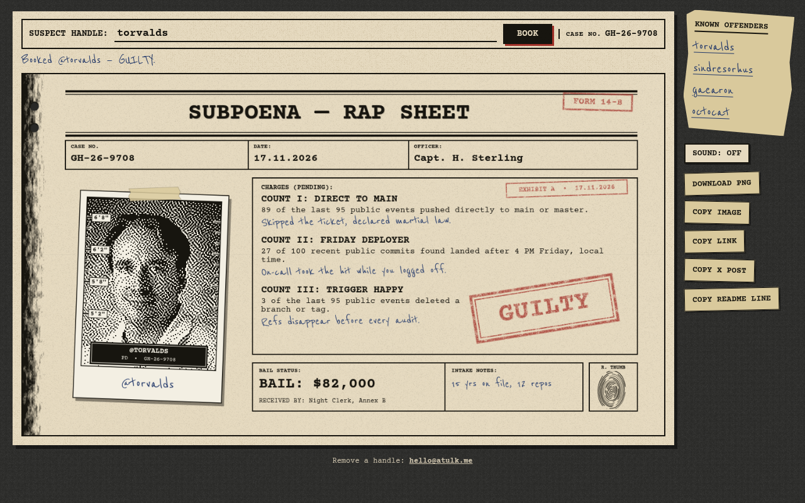
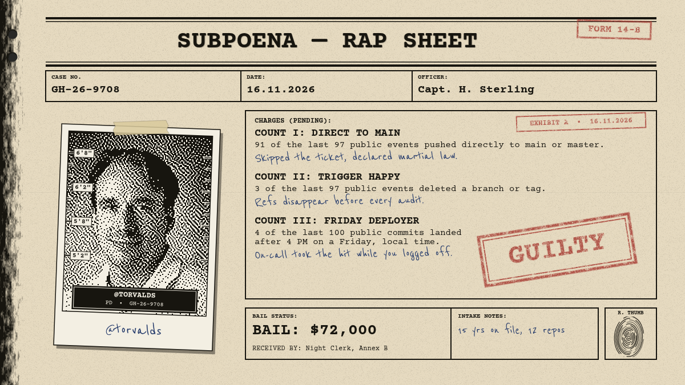
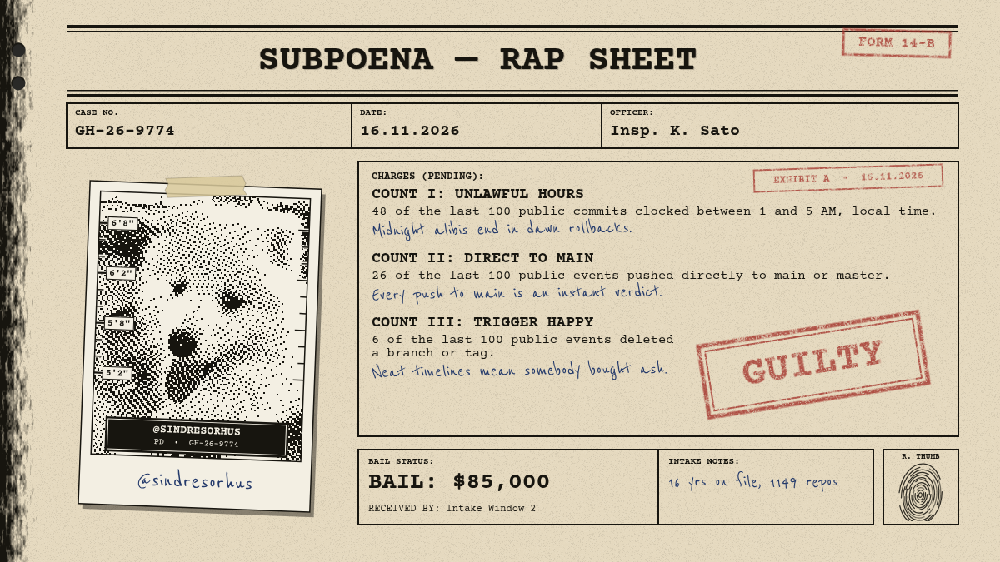

# Subpoena

Form 14-B courtroom noir GitHub intake form and printable 1200x675 rap-sheet generator. Subpoena inspects public GitHub repositories, commits, and activity events to file deterministic statutory counts, render an Atkinson-dithered mugshot and procedural fingerprint, and serve server-side PNG cards and dynamic Open Graph previews.

## Screenshots



| Rendered Rap Sheet (`torvalds`) | Rendered Rap Sheet (`sindresorhus`) |
| --- | --- |
|  |  |

## Local Development

```bash
npm install
npm run dev
```

Run tests and production build checks:

```bash
npm test
npm run build
```

## Environment Variables

- `GITHUB_TOKEN`: GitHub personal access token used by `/api/gh`, `/api/card`, and `/api/health` to query the GitHub REST and commit-search APIs without anonymous rate-limiting. Required in production deployments; optional in local development (falls back to bundled snapshots or `gh auth token` when available).
